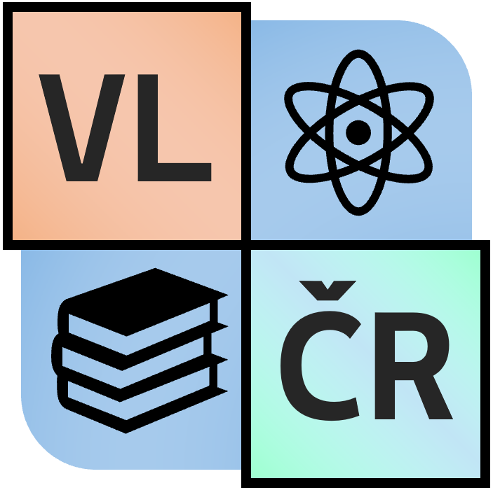

<!-- 
  Tento první slide má direktivu _class: lead, 
  takže se vycentruje na střed podle definice section.lead 
-->
<!-- _class: lead -->

<!--
_backgroundImage: "linear-gradient(to top, rgba(255,255,255,1) 0%, rgba(255,255,255,0) 500%), url('stanek.jpeg')"
-->

# Vzdělaný lid České republiky
---
<!--
_backgroundImage: "linear-gradient(to top, rgb(251, 248, 248) 0%, rgba(0,0,0,0) 40%), url('mantinel.jpg')"
-->
---
<!--
_backgroundImage: "linear-gradient(to top, rgba(0, 0, 0, 0.67) 0%, rgba(0,0,0,0) 40%), url('stanek.jpeg')"
-->
---